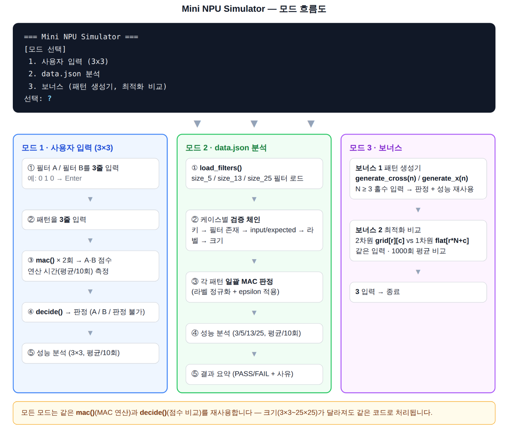
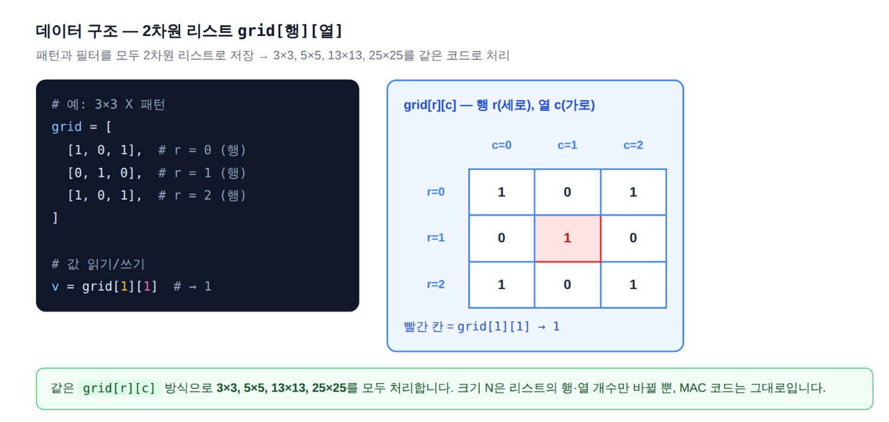
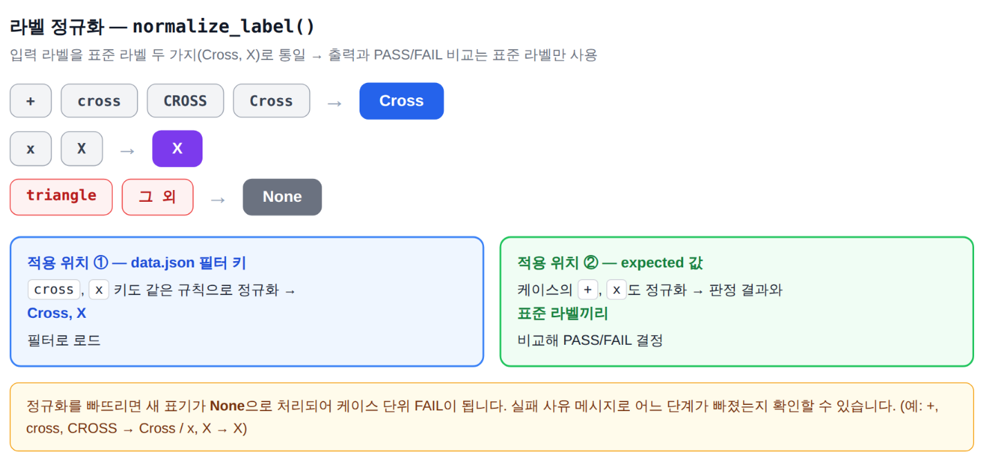
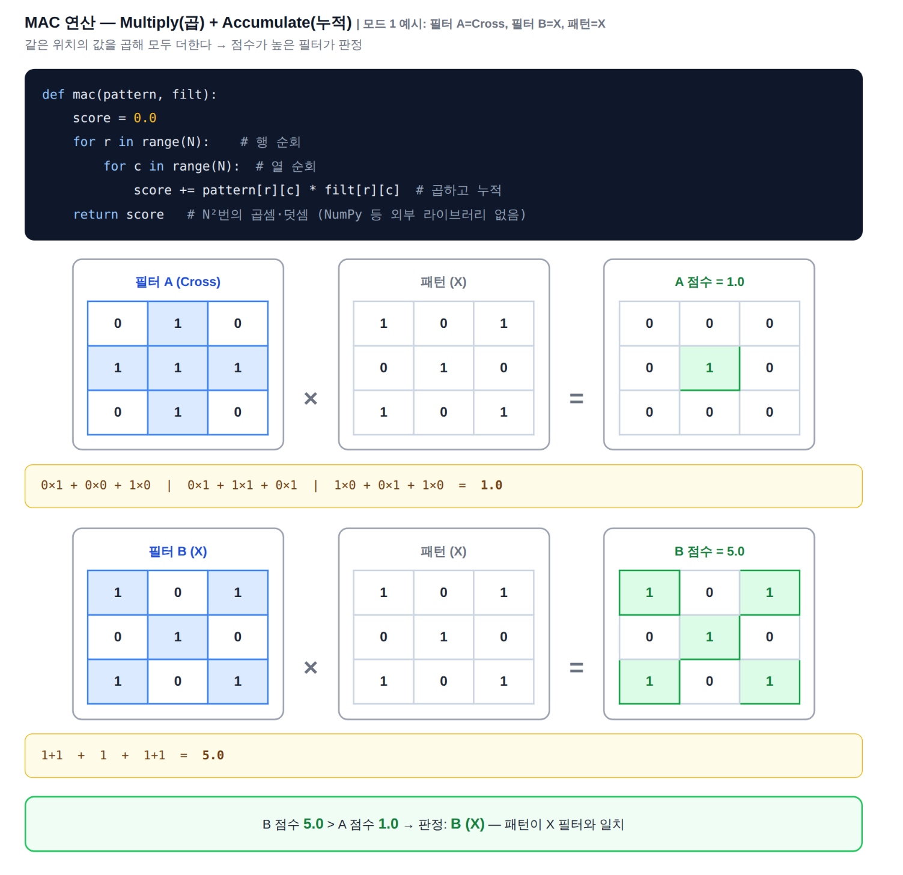
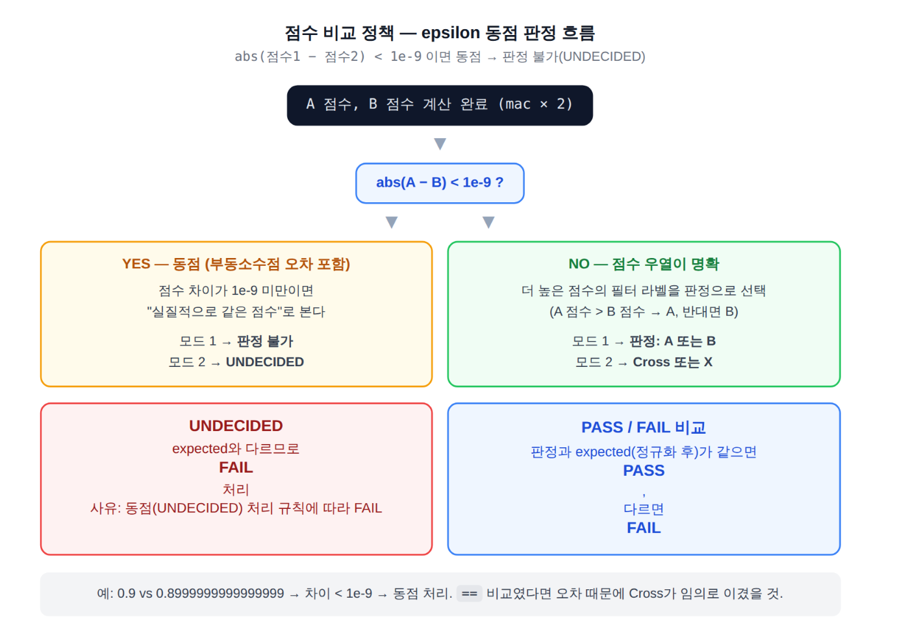
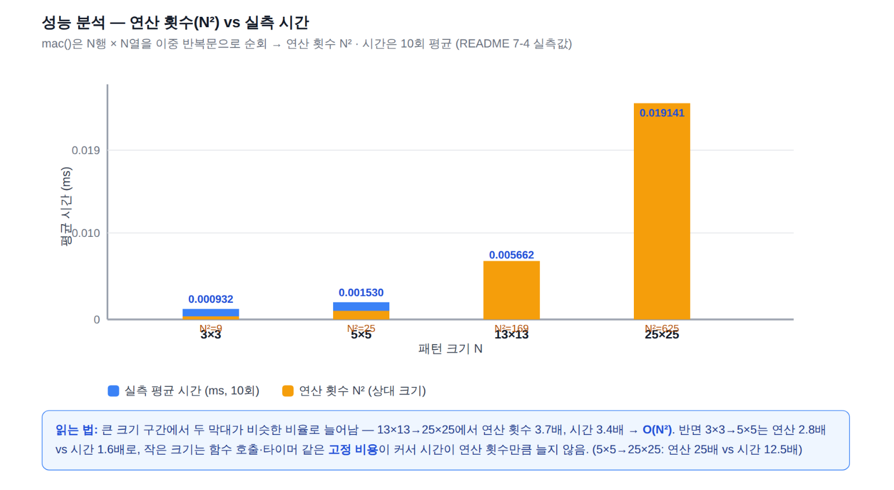
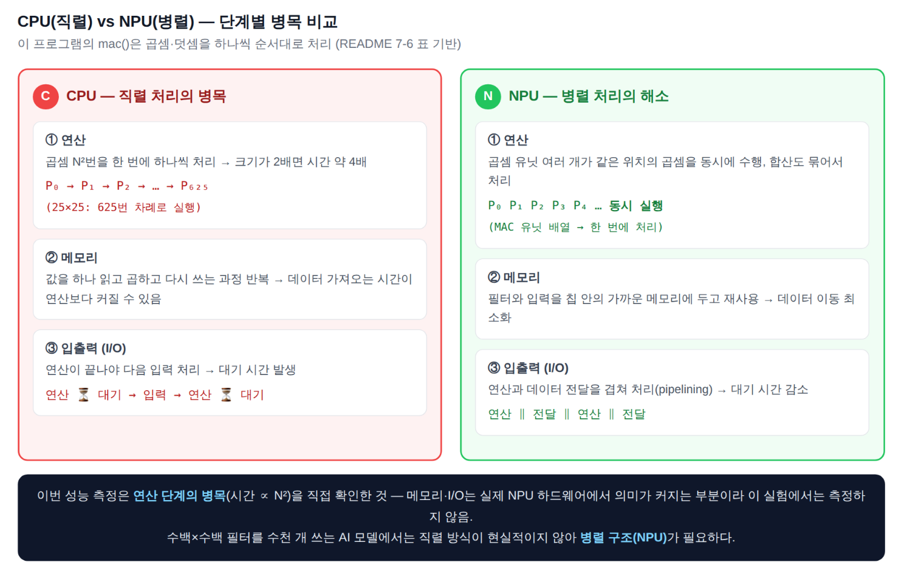
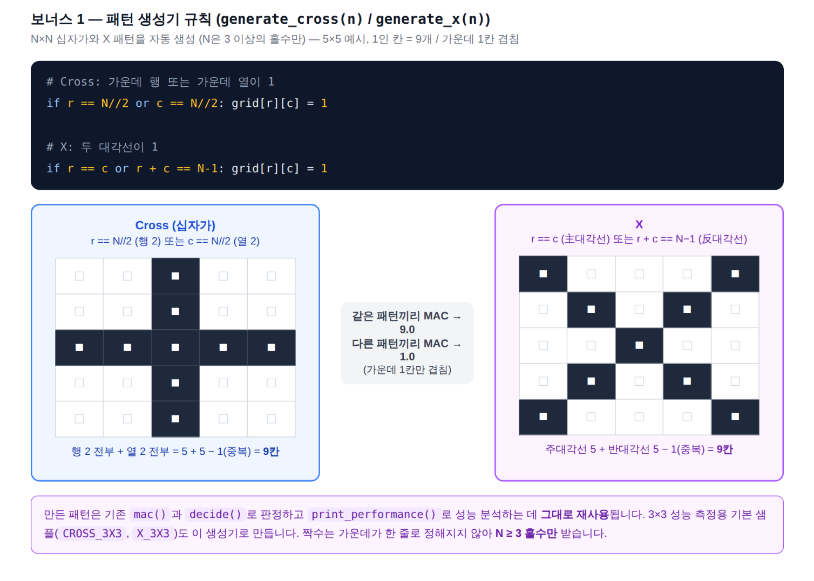
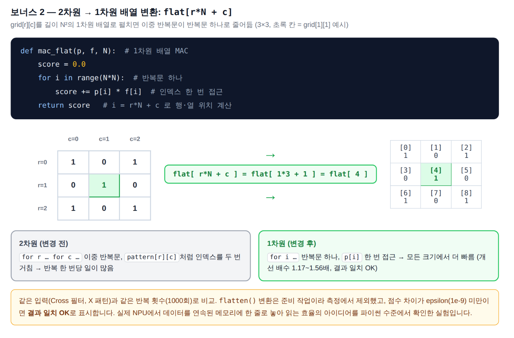

# Mini NPU 시뮬레이터(Codyssey3-3)

3×3~25×25 패턴이 십자가(Cross)인지 X인지 MAC 연산으로 판별하고, 크기별 연산 시간을 측정하는 콘솔 시뮬레이터

## 목차
1. 프로젝트 개요
2. 개발 환경
3. 실행 방법
4. 파일 구조
5. 구현 요약
6. 실행 예시
7. 결과 리포트
8. 보너스 과제 (선택)
9. 제출물 체크리스트

## 1. 프로젝트 개요

NPU의 핵심 연산인 **MAC(Multiply-Accumulate, 곱하고 누적해서 더하기)**을 파이썬 반복문으로 직접 구현해, 입력 패턴이 십자가(Cross)인지 X인지 판별하는 콘솔 프로그램이다. 3×3부터 25×25까지의 크기를 처리하고, 크기가 커질 때 연산 시간이 어떻게 변하는지 측정한다.

- **모드 1:** 3×3 필터 2개(A, B)와 패턴을 직접 입력해 점수, 연산 시간, 판정을 확인한다.
- **모드 2:** `data.json`의 필터(5×5, 13×13, 25×25)와 패턴을 일괄 판정하고, 성능 분석과 결과 요약을 출력한다.
- **모드 3 :** N×N 십자가·X 패턴을 자동 생성해 판정하고, 2차원 배열 MAC과 1차원 배열 MAC의 시간을 비교한다.




## 2. 개발 환경

| 항목 | 내용 |
|---|---|
| OS | Ubuntu on WSL |
| 에디터 | VS Code (WSL 연결) |
| Python | Python (python3 --version 결과로 교체), 필요 버전 3.8 이상 |
| 외부 라이브러리 | 없음 (`json`, `math`, `os`, `time` 표준 라이브러리만 사용) |

## 3. 실행 방법

`main.py`와 `data.json`이 있는 폴더(프로젝트 루트)에서 실행한다.

```bash
python3 main.py
```

실행하면 모드를 선택한다.

```text
=== Mini NPU Simulator ===
[모드 선택]
1. 사용자 입력 (3x3)
2. data.json 분석
3. 보너스 (패턴 생성기, 최적화 비교)
선택:
```

- **모드 1:** 필터 A, 필터 B, 패턴을 각각 **3줄**로 입력한다. 한 줄에 숫자 3개를 공백으로 구분해 입력하고 Enter를 누른다. (예: `0 1 0`)
- **모드 2:** 별도 입력 없이 `data.json`을 읽어 자동으로 분석한다. `data.json`은 `main.py`와 같은 폴더에 있어야 한다.
- **모드 3 (보너스):** 보너스 메뉴에서 `1`(패턴 생성기, 3 이상의 홀수 N 입력) 또는 `2`(최적화 전/후 비교)를 고른다. `3`을 입력하면 종료한다.

## 4. 파일 구조

```text
Codyssey3-3/
├── main.py       # 메인 실행 파일 (모드 1, 모드 2, 보너스 모드 3, 성능 분석)
├── data.json     # 모드 2에서 읽는 필터와 패턴 데이터
├── README.md     # 이 문서
└── .gitignore    # Git이 추적하지 않을 파일 목록
```

## 5. 구현 요약

### 5-1. 데이터 구조
패턴과 필터는 파이썬의 **2차원 리스트**(`grid[행][열]`)로 저장한다. 위치 값은 `grid[r][c]`로 읽고 쓰며, 3×3, 5×5, 13×13, 25×25 크기를 같은 코드로 처리한다.


그림 2. 2차원 리스트 grid[r][c] — 코드와 격자를 나란히 놓아 행(r)·열(c) 인덱스가 실제 칸 위치와 어떻게 대응되는지 보여준다. 크기 N은 리스트의 행·열 개수만 바뀔 뿐 MAC 코드는 그대로라는 점이 핵심이다

### 5-2. 라벨 정규화
`normalize_label()`이 입력 라벨을 표준 라벨 두 가지(`Cross`, `X`)로 바꾼다. `+`, `cross`(대소문자 무시)는 `Cross`, `x`는 `X`로 바꾸고, 그 외는 `None`으로 처리한다. `data.json`의 **필터 키**(`cross`, `x`)와 **expected 값**(`+`, `x`) 모두에 적용하며, 출력과 PASS/FAIL 비교는 표준 라벨만 사용한다. (예: `+`, `cross`, `CROSS` → `Cross`, `x`, `X` → `X`)



### 5-3. MAC 연산
`mac()`이 패턴과 필터를 **이중 반복문**으로 순회하며 같은 위치의 값을 곱해 누적한다. NumPy 같은 외부 라이브러리는 사용하지 않았다.



### 5-4. 점수 비교 정책 (epsilon)
`abs(점수1 - 점수2) < 1e-9`이면 동점으로 본다. 모드 1은 `판정 불가`, 모드 2는 `UNDECIDED`로 출력하며, UNDECIDED는 expected와 다르므로 FAIL로 처리한다.



### 5-5. 입력과 스키마 검증
- **모드 1:** 줄마다 열 개수와 숫자 변환을 검사하고, `nan`/`inf`는 거부한다. 틀린 줄만 안내 문구(`입력 형식 오류: ...`)와 함께 다시 입력받는다.
- **모드 2:** 케이스마다 키(크기 N) → 필터 존재 → `input`/`expected` 항목 → 라벨 → 패턴 크기 순서로 검사한다. 문제가 있으면 그 케이스만 FAIL과 사유를 남기고 **프로그램은 계속 진행**한다. 파일이 없거나 JSON 문법이 틀려도 안내 후 정상 종료한다.

### 5-6. 새 라벨을 추가하는 절차

현재 프로그램은 `Cross`와 `X` 두 라벨만 비교한다. 새 라벨(예: `Triangle`)을 추가하려면 아래 순서로 고친다.

1. **정규화 규칙 추가:** `normalize_label()`에 새 표기를 표준 라벨로 바꾸는 규칙을 넣는다. (예: `"triangle"`, `"^"` → `"Triangle"`)
2. **필터 추가:** `data.json`의 `filters` 각 크기(`size_5` 등)에 새 라벨의 필터 격자를 넣는다.
3. **필터 검사 조건 수정:** `load_filters()`가 `set(standard) != {"Cross", "X"}`로 라벨이 정확히 두 개인지 검사하므로, 새 라벨을 포함하도록 고친다.
4. **판정 로직 확장:** `decide()`는 점수 두 개만 비교한다. 라벨이 셋 이상이면 모든 필터 점수를 구해 **가장 높은 점수의 라벨**을 고르고, 1등과 2등의 차이가 `EPSILON` 미만이면 `UNDECIDED`로 처리하도록 바꾼다.
5. **출력 수정:** `run_case()`와 `print_case()`가 `Cross`, `X` 점수만 출력하므로 새 라벨 점수도 출력하도록 고친다.
6. **테스트 케이스 작성:** `patterns`에 새 라벨 패턴과 `expected` 값을 추가하고, 실행해서 PASS/FAIL이 기대대로 나오는지 확인한다.

정규화(1단계)와 필터 검사(3단계)를 빠뜨리면 새 라벨이 `None`이나 형식 오류로 처리되어 **케이스 단위 FAIL**이 되므로, 실패 사유 메시지로 어느 단계가 빠졌는지 확인할 수 있다.

## 6. 실행 예시

### 6-1. 모드 1 (3×3 사용자 입력)

```text
=== Mini NPU Simulator ===
[모드 선택]
1. 사용자 입력 (3x3)
2. data.json 분석
3. 보너스 (패턴 생성기, 최적화 비교)
선택: 1
#---------------------------------------
# [1] 필터 입력
#---------------------------------------
필터 A (3줄 입력, 공백 구분)
0 1 0
1 1 1
0 1 0
필터 B (3줄 입력, 공백 구분)
1 0 1
0 1 0
1 0 1
✓ 필터 A, B 저장 완료
필터 A:
  0.0 1.0 0.0
  1.0 1.0 1.0
  0.0 1.0 0.0
필터 B:
  1.0 0.0 1.0
  0.0 1.0 0.0
  1.0 0.0 1.0
#---------------------------------------
# [2] 패턴 입력
#---------------------------------------
패턴 (3줄 입력, 공백 구분)
1 0 1
0 1 0
1 0 1
#---------------------------------------
# [3] MAC 결과
#---------------------------------------
A 점수: 1.0
B 점수: 5.0
연산 시간(평균/10회): 0.000963 ms
판정: B
#---------------------------------------
# [4] 성능 분석 (3×3, 평균/10회)
#---------------------------------------
크기        평균 시간(ms)         연산 횟수(N²) 
--------------------------------------
3×3       0.000470          9         
```

필터 A는 십자가, 필터 B는 X이고 패턴은 X이다. 패턴이 X 필터와 일치해 B 점수(5.0)가 A 점수(1.0)보다 높고, 판정은 B이다.

### 6-2. 모드 2 (data.json 분석)

```text
=== Mini NPU Simulator ===
[모드 선택]
1. 사용자 입력 (3x3)
2. data.json 분석
3. 보너스 (패턴 생성기, 최적화 비교)
선택: 2
#---------------------------------------
# [1] 필터 로드
#---------------------------------------
✓ size_5 필터 로드 완료 (Cross, X)
✓ size_13 필터 로드 완료 (Cross, X)
✓ size_25 필터 로드 완료 (Cross, X)
#---------------------------------------
# [2] 패턴 분석 (라벨 정규화 적용)
#---------------------------------------
--- size_5_1 ---
Cross 점수: 0.9
X 점수: 0.8999999999999999
판정: UNDECIDED | expected: X | FAIL
  사유: 동점(UNDECIDED) 처리 규칙에 따라 FAIL
--- size_5_2 ---
Cross 점수: 8.9
X 점수: 0.1
판정: Cross | expected: Cross | PASS
--- size_13_1 ---
Cross 점수: 0.3
X 점수: 14.700000000000008
판정: X | expected: X | PASS
--- size_13_2 ---
Cross 점수: 7.499999999999997
X 점수: 7.5
판정: UNDECIDED | expected: Cross | FAIL
  사유: 동점(UNDECIDED) 처리 규칙에 따라 FAIL
--- size_25_1 ---
Cross 점수: 4.9
X 점수: 4.899999999999999
판정: UNDECIDED | expected: X | FAIL
  사유: 동점(UNDECIDED) 처리 규칙에 따라 FAIL
--- size_25_2 ---
Cross 점수: 52.9
X 점수: 0.1
판정: Cross | expected: Cross | PASS
#---------------------------------------
# [3] 성능 분석 (평균/10회)
#---------------------------------------
크기        평균 시간(ms)         연산 횟수(N²) 
--------------------------------------
3×3       0.000932          9         
5×5       0.001530          25        
13×13     0.005662          169       
25×25     0.019141          625       
#---------------------------------------
# [4] 결과 요약
#---------------------------------------
총 테스트: 6개
통과: 3개
실패: 3개
실패 케이스:
- size_5_1: 동점(UNDECIDED) 처리 규칙에 따라 FAIL
- size_13_2: 동점(UNDECIDED) 처리 규칙에 따라 FAIL
- size_25_1: 동점(UNDECIDED) 처리 규칙에 따라 FAIL
```

## 7. 결과 리포트

### 7-1. 테스트 결과 요약

`data.json` 분석 결과는 **총 6개 중 통과 3개, 실패 3개**이다.

| 케이스 | Cross 점수 | X 점수 | 판정 | expected | 결과 |
|---|---|---|---|---|---|
| size_5_1 | 0.9 | 0.8999999999999999 | UNDECIDED | X | FAIL |
| size_5_2 | 8.9 | 0.1 | Cross | Cross | PASS |
| size_13_1 | 0.3 | 14.700000000000008 | X | X | PASS |
| size_13_2 | 7.499999999999997 | 7.5 | UNDECIDED | Cross | FAIL |
| size_25_1 | 4.9 | 4.899999999999999 | UNDECIDED | X | FAIL |
| size_25_2 | 52.9 | 0.1 | Cross | Cross | PASS |

### 7-2. 실패 원인 분석

실패 3개(`size_5_1`, `size_13_2`, `size_25_1`)는 모두 두 필터의 점수가 사실상 같아 UNDECIDED가 된 경우이다. 원인을 세 가지로 나누어 진단했다.

| 구분 | 진단 | 근거 |
|---|---|---|
| 데이터/스키마 문제 | 해당 없음 | 모든 라벨이 정규화되었고, 6개 케이스의 패턴과 필터 크기가 일치했다. |
| 로직 문제 | 해당 없음 | 모드 1에서 십자가·X 필터와 X 패턴으로 A=1.0, B=5.0이 나와 MAC과 판정이 맞았고, 정상 케이스 3개는 PASS였다. |
| 수치 비교 문제 | **해당** | 필터에 0.9, 4.9, 7.5처럼 1이 아닌 값이 섞여 있어, 수학적으로는 같은 점수(0.9와 0.9, 7.5와 7.5, 4.9와 4.9)가 나오는 케이스가 있다. |

세 FAIL은 코드의 오류가 아니라 **필터 값의 구성 때문에 생긴 동점**이며, 동점은 판정할 수 없다는 규칙에 따라 FAIL로 처리했다. 라벨이나 크기 문제로 인한 FAIL은 0건이다.

### 7-3. epsilon과 정규화 정책의 영향

실제 점수에는 부동소수점 오차가 나타났다. 같아야 하는 0.9와 0.8999999999999999, 7.5와 7.499999999999997, 4.9와 4.899999999999999는 컴퓨터가 0.1 같은 값을 2진수로 정확히 표현하지 못해서 미세하게 다르다. (`0.1 + 0.2 == 0.3`이 `False`인 것과 같은 원리이다.)

만약 `==`나 `>`로만 비교했다면 `size_5_1`과 `size_25_1`은 Cross가, `size_13_2`는 X가 우세하다고 **오차 때문에 임의로** 판정했을 것이다. epsilon(`1e-9`) 정책은 이런 오차를 동점으로 묶어 UNDECIDED로 **일관되게** 처리한다.

라벨 정규화(`+`→Cross, `x`→X, 필터 키 `cross`→Cross)를 적용해, 표기 차이로 PASS/FAIL이 어긋나는 경우는 없었다. 그래서 FAIL 원인이 동점 하나로 분리되어 진단할 수 있었다.

### 7-4. 성능 분석

| 크기 | 평균 시간(ms, 10회) | 연산 횟수(N²) |
|---|---:|---:|
| 3×3 | 0.000932 | 9 |
| 5×5 | 0.001530 | 25 |
| 13×13 | 0.005662 | 169 |
| 25×25 | 0.019141 | 625 |

| 비교 | 연산 횟수 배수(N²) | 실측 시간 배수 |
|---|---:|---:|
| 3×3 → 5×5 | 2.8배 | 1.6배 |
| 5×5 → 13×13 | 6.8배 | 3.7배 |
| 13×13 → 25×25 | 3.7배 | 3.4배 |
| 5×5 → 25×25 | 25배 | 12.5배 |




크기가 클수록 연산 횟수와 시간이 비슷한 비율로 늘어난다. 13×13에서 25×25로 갈 때 연산 횟수는 3.7배, 시간은 3.4배였다. 반면 3×3처럼 작은 크기는 함수 호출과 타이머 같은 **고정 비용**이 연산 시간보다 커서 시간이 연산 횟수만큼 늘지 않았다(2.8배 대 1.6배).

모드 1의 "연산 시간"(0.000963 ms)이 모드 1 성능 표의 3×3(0.000470 ms)보다 큰 것은, 모드 1은 필터 A와 B **두 번의 MAC**을 합쳐서 측정하기 때문이다.


### 7-5. 시간 복잡도 O(N²) 근거

`mac()`은 N행 × N열을 이중 반복문으로 순회하며 곱셈과 덧셈을 N×N번 수행하므로, 크기 N에 대한 연산 횟수는 N²이다. 크기가 2배가 되면 연산 횟수는 4배, 5배가 되면 25배가 된다. 위 표에서 큰 크기 구간의 실측 시간 증가 비율이 연산 횟수 증가 비율(N²)과 비슷하므로, 시간 복잡도는 **O(N²)**라고 설명할 수 있다. 시간 측정값은 실행할 때마다 달라지므로 10회 평균을 사용했다.

AI 모델은 수백×수백 크기의 필터를 수천 개 사용하므로 N²으로 늘어나는 연산량이 매우 커지고, 이 반복 연산을 한꺼번에 처리하는 병렬 구조가 NPU가 필요한 이유이다.

### 7-6. CPU(직렬)와 NPU(병렬)의 병목 비교

이 프로그램의 `mac()`은 곱셈과 덧셈을 **하나씩 순서대로**(직렬) 처리한다. 25×25 필터는 625번을 차례로 실행하므로 시간이 N²에 비례해 늘었다. 이 구조에서 병목이 생기는 지점을 단계별로 비교했다.

| 단계 | CPU(직렬) 방식의 병목 | NPU(병렬) 방식의 해소 |
|---|---|---|
| 연산 | 곱셈 N²번을 한 번에 하나씩 처리하므로, 크기가 2배면 시간이 약 4배가 된다. | 곱셈 유닛 여러 개가 같은 위치의 곱셈을 **동시에** 수행하고, 합산도 묶어서 처리해 연산 시간이 줄어든다. |
| 메모리 | 값을 하나 읽고 곱하고 다시 쓰는 과정이 반복되어, 데이터를 가져오는 시간이 연산 시간보다 커질 수 있다. | 필터와 입력을 칩 안의 가까운 메모리에 두고 재사용해 데이터 이동을 줄인다. |
| 입출력(I/O) | 연산이 끝나야 다음 입력을 처리하므로 대기 시간이 생긴다. | 연산과 데이터 전달을 겹쳐 처리해 대기 시간을 줄인다. |

이번 성능 측정은 I/O를 제외하고 `mac()` 호출 구간만 쟀으므로, 위 표 중 **연산 단계의 병목**(시간이 N²에 비례해 증가)을 직접 확인한 것이다. 메모리와 I/O는 실제 NPU 하드웨어에서 의미가 커지는 부분이라 이 실험에서는 측정하지 않았다. AI 모델처럼 수백×수백 필터를 수천 개 적용하는 경우, 직렬 방식은 시간이 현실적이지 않아 병렬 처리 구조가 필요하다.



## 8. 보너스 과제 (선택)

보너스 과제 두 가지를 모드 3(보너스)으로 구현했다.

### 8-1. 패턴 생성기

크기 N을 입력하면 N×N 십자가(Cross)와 X 패턴을 자동으로 만든다. 만든 패턴은 기존 `mac()`과 `decide()`로 판정하고 `print_performance()`로 성능을 분석하는 데 그대로 재사용한다. 3×3 성능 측정용 기본 샘플(`CROSS_3X3`, `X_3X3`)도 이 생성기로 만든다.

| 패턴 | 규칙 | 함수 |
|---|---|---|
| Cross | 가운데 행(`r == N//2`) 또는 가운데 열(`c == N//2`)이 1 | `generate_cross(n)` |
| X | 두 대각선(`r == c` 또는 `r + c == N-1`)이 1 | `generate_x(n)` |

- **N은 3 이상의 홀수만 받는다.** 짝수는 가운데가 한 줄로 정해지지 않아 대칭 모양이 만들어지지 않기 때문이다. 숫자가 아니거나 짝수·3 미만, 빈 입력이면 안내 후 다시 입력받는다.

```text
[생성된 Cross 5×5]
□ □ ■ □ □
□ □ ■ □ □
■ ■ ■ ■ ■
□ □ ■ □ □
□ □ ■ □ □

[생성된 X 5×5]
■ □ □ □ ■
□ ■ □ ■ □
□ □ ■ □ □
□ ■ □ ■ □
■ □ □ □ ■
#---------------------------------------
# 생성한 패턴 판정 (필터 A = Cross, 필터 B = X)
#---------------------------------------
입력 Cross| A 점수: 9.0 | B 점수: 1.0 | 판정: Cross | expected: Cross | PASS
입력 X    | A 점수: 1.0 | B 점수: 9.0 | 판정: X | expected: X | PASS
#---------------------------------------
# 성능 분석 (5×5, 평균/10회)
#---------------------------------------
크기        평균 시간(ms)         연산 횟수(N²) 
--------------------------------------
5×5       0.001919          25        
```

5×5에서 Cross와 X는 각각 9칸이 1이고 가운데 한 칸만 겹친다. 그래서 같은 패턴끼리는 9.0, 다른 패턴끼리는 1.0이 나온다.



### 8-2. 시뮬레이터 최적화 (1차원 배열)

2차원 배열 `grid[r][c]`를 길이 N²의 1차원 배열로 펼치면(`flat[r*N + c]`) 이중 반복문이 반복문 하나로 줄어들어 접근 패턴이 단순해진다. 두 방식에 **같은 입력(Cross 필터, X 패턴)과 같은 반복 횟수(1000회)** 를 주고 평균 시간을 비교했다.

- **변환 비용:** `flatten()`은 준비 작업으로 한 번만 하면 되므로 측정에서 제외했다.
- **정확성:** 두 방식의 점수 차이가 epsilon(`1e-9`) 미만이면 `결과 일치`를 `OK`로 표시한다. 행을 차례로 이어 붙여 같은 순서로 곱하고 더하므로 점수는 같다.

```text
크기        2차원(ms)       1차원(ms)       개선 배수       결과 일치   
----------------------------------------------------------
3×3       0.000814      0.000523      1.56        OK      
5×5       0.001718      0.001106      1.55        OK      
13×13     0.009033      0.006929      1.30        OK      
25×25     0.030891      0.026411      1.17        OK      
```

- **해석:** `개선 배수`는 (2차원 시간) ÷ (1차원 시간)이다. 1보다 크면 1차원 방식이 빠른 것이다. 모든 크기에서 1차원이 더 빨랐고, 크기가 커질수록 개선 폭이 줄었다(1.56배 → 1.17배). 2차원은 `pattern[r][c]`처럼 인덱스를 두 번 거치고 바깥 반복문도 한 번 더 돌지만, 1차원은 `p[i]` 한 번과 반복문 하나라서 반복 한 번당 일이 적다. 값은 실행할 때마다, 컴퓨터마다 달라지므로 같은 조건의 전/후 비교로만 해석한다.
- **의미:** 실제 NPU에서는 데이터를 연속된 메모리에 한 줄로 놓아 읽는 것이 효율에 크게 영향을 준다. 이 실험은 그 아이디어를 파이썬 수준에서 확인해 본 것이다.



## 9. 제출물 체크리스트

- [x] `main.py`: 모드 1(사용자 입력), 모드 2(`data.json` 분석), 모드 3(보너스), 성능 분석 구현
- [x] `README.md`: 실행 방법, 구현 요약, 실행 예시, 결과 리포트
- [x] 외부 라이브러리 없이 표준 라이브러리(`json`, `math`, `os`, `time`)만 사용
- [x] 라벨 정규화(`+`, `x`, `cross` → `Cross`, `X`)와 epsilon(`1e-9`) 비교 적용
- [x] 의도적 오류 입력(열 개수 불일치, 숫자 아님)에 안내 문구 후 재입력
- [x] 결과 리포트에 실패 원인 분석과 시간 복잡도 O(N²) 근거 서술
- [x] 보너스 1: 시뮬레이터 최적화(2차원 → 1차원 배열) 전/후 성능 비교
- [x] 보너스 2: 패턴 생성기(N×N Cross/X)와 판정·성능 분석 재사용